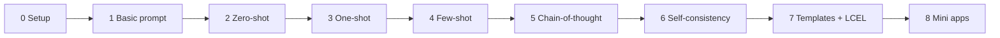
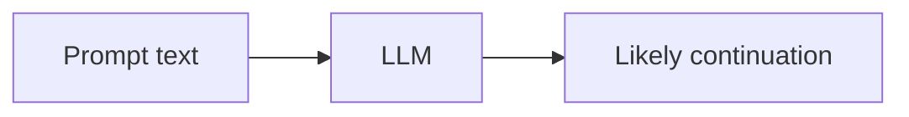
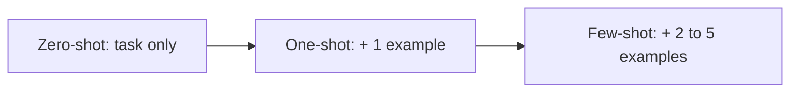
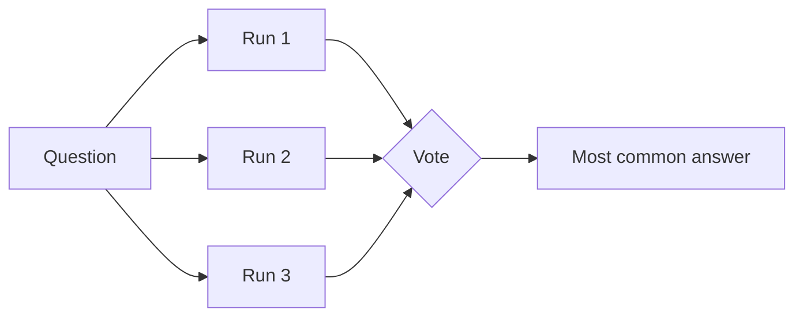
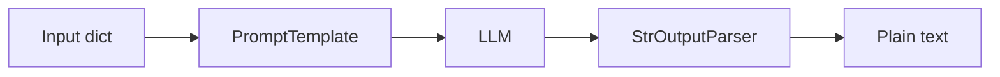
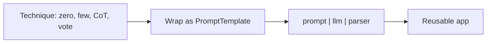

# Tutorial 1: Prompt Engineering and Prompt Templates (LangChain + OpenAI)

Follow-along version of the lab **In-Context Learning and Prompt Templates for Advanced AI**. The lab uses IBM watsonx.ai (Granite). Here every step uses LangChain with OpenAI (`ChatOpenAI`, `gpt-4o-mini`). The ideas are identical. Only the model line changes.

**What you will be able to do**

- Write basic, zero-shot, one-shot, few-shot, chain-of-thought and self-consistency prompts.
- Turn a prompt into a reusable LangChain `PromptTemplate` and run it with `prompt | llm | parser`.
- Build small apps from templates: summarizer, Q&A, classifier, SQL generator, role-play bot.

Related: the longer course-order guide is [course1 module1 tutorial 1](../../course1-develop-generative-ai-application/module1/tutorials/01-genai-and-prompting-adapted.md).

## How to use this guide

1. Open a new notebook (or a `.py` file) at the repo root. Use the root `.venv`.
2. Type each **Type this** block yourself, in order. Later blocks reuse earlier names.
3. Each step: **The problem**, **The fix**, **Type this**, **What you should see**, **Try it**.
4. LLM text varies. Expect the idea, not the exact words.
5. The whole guide costs a few cents.



---

## Step 0: Setup (replaces the watsonx cells)

**The problem.** The lab installs pinned old packages and builds a `WatsonxLLM` with credentials. You do not need any of that.

**The fix.** Put `OPENAI_API_KEY=sk-...` in the repo-root `.env`, then create one model object and one helper.

**Type this.**

```python
from dotenv import load_dotenv
from langchain_openai import ChatOpenAI

load_dotenv()
llm = ChatOpenAI(model="gpt-4o-mini", temperature=0.5)

# bind() sets per-call options, like the lab's params dict
def ask(prompt, **settings):
    return llm.bind(**settings).invoke(prompt).content

print(ask("Say hello in five words."))
```

**What you should see.** A short greeting.

> **Lab says / today we use:** `llm_model(prompt_txt, params)` with `max_new_tokens`, `min_new_tokens`, `top_p`, `top_k` on `WatsonxLLM`. We use `ask(prompt, max_tokens=..., temperature=...)`. OpenAI has `max_tokens`, `temperature` and `top_p`. It has no `min_new_tokens` or `top_k`, so those lab settings have no equivalent.

**Try it.** Compare with watsonx: the line `ChatOpenAI(model="gpt-4o-mini")` is the only line that would change back to `WatsonxLLM(model_id="ibm/granite-4-h-small", ...)`.

---

## Step 1: Basic prompt

**The problem.** What does a model do with almost no instruction?

**The fix.** Give it a start and let it continue. A model predicts the next words, so a question is just a start that usually continues with an answer.

**Type this.**

```python
print(ask("The wind is ", max_tokens=40))
print("---")
print(ask("The wind is ", max_tokens=40))
```

**What you should see.** Two different, possibly cut-off sentences about wind. They are cut off because `max_tokens` caps the length. They differ because `temperature=0.5` adds randomness.

**Try it.** Set `temperature=0` in the call. The answers become (nearly) identical. Try the lab's Exercise 1 prompts: "The future of artificial intelligence is", "Once upon a time in a distant galaxy".



---

## Step 2: Zero-shot prompt

**The problem.** A bare start gives rambling. You want a specific job done.

**The fix.** State the task clearly, with no examples. The model uses what it learned in training. This is **zero-shot**.

**Type this.**

```python
prompt = """Classify the following statement as true or false:
'The Eiffel Tower is located in Berlin.'

Answer:"""
print(ask(prompt, max_tokens=60))
```

**What you should see.** "False", often with a reason.

**Try it.** Lab Exercise 2: write zero-shot prompts to classify a movie review, summarize a paragraph in two sentences, and translate a phrase to Spanish.

---

## Step 3: One-shot prompt

**The problem.** Zero-shot can answer in a format you did not want.

**The fix.** Show **one** worked example first. The model copies the pattern.

**Type this.**

```python
prompt = """Example of translating English to French:
English: "How is the weather today?"
French: "Comment est le temps aujourd'hui ?"

Now translate:
English: "Where is the nearest supermarket?"
French:"""
print(ask(prompt, temperature=0.1, max_tokens=30))
```

**What you should see.** Just the French sentence, in the same quoted style as the example.

**Try it.** Lab Exercise 3: give one example of a formal email, then ask for another on a different topic. Or one example of keyword extraction, then a new sentence.

---

## Step 4: Few-shot prompt

**The problem.** One example may not fix the pattern (is the label one word? a sentence?).

**The fix.** Give two to five examples. More examples make the pattern harder to miss.

**Type this.**

```python
prompt = """Classify the emotion in each statement.

Statement: 'I just won my first marathon!'
Emotion: Joy

Statement: 'I can't believe I lost my keys again.'
Emotion: Frustration

Statement: 'My best friend is moving to another country.'
Emotion: Sadness

Statement: 'That movie was so scary I had to cover my eyes.'
Emotion:"""
print(ask(prompt, temperature=0, max_tokens=5))
```

**What you should see.** One word, such as "Fear". `max_tokens=5` forces a short answer.

**Why it works.** The prompt is a pattern that ends mid-pattern, so the likeliest continuation is one more label. This is **in-context learning**: the model learns the task from the prompt itself, with no training.

**Try it.** Change the last statement. Add a fourth example with an emotion that is not in the list and see if the answer changes.



---

## Step 5: Chain-of-thought (CoT)

**The problem.** Multi-step arithmetic or logic sometimes comes out wrong when the model jumps to an answer.

**The fix.** Ask it to show its steps. Writing the steps gives the model room to reason before it commits.

**Type this.**

```python
prompt = """A store had 22 apples. They sold 15 apples today and got a new delivery of 8 apples.
How many apples are there now?

Break down each step of your calculation."""
print(ask(prompt, max_tokens=300))
```

**What you should see.** Numbered steps (22 - 15 = 7, then 7 + 8 = 15) and the answer 15.

**Try it.** Lab Exercise 4: ask the model to think through "study tonight or go to a movie when I have a test in two days", and to explain how to make a peanut butter and jelly sandwich step by step.

---

## Step 6: Self-consistency

**The problem.** Even with steps, one run can reach a wrong answer.

**The fix.** Sample several answers and keep the one most runs agree on. The lab asks for "three independent calculations" in one prompt. Below you do the real thing: three separate runs, then a vote.

**Type this.**

```python
from collections import Counter

question = """When I was 6, my sister was half of my age. Now I am 70.
How old is my sister? Think step by step, then end with 'Final answer: <number>'."""

# temperature=1 so the three runs can take different routes
runs = llm.bind(temperature=1, max_tokens=300).batch([question] * 3)
answers = [r.content.split("Final answer:")[-1].strip(" .\n*") for r in runs]
print(answers)
print(Counter(answers).most_common(1))
```

**What you should see.** A list like `['67', '67', '67']` and the winner `('67', 3)`. (Sister was 3 when you were 6, so she is 3 years younger: 70 - 3 = 67. A common wrong answer is 35.)

> **Lab says / today we use:** the lab puts "provide three independent calculations" inside one prompt. We run the prompt three times and vote, which is how self-consistency is described in the research. Both ideas are the same: compare several attempts.

**Try it.** Raise the count to 5. Try a different puzzle and look at when the runs disagree.



---

## Step 7: Prompt templates and LCEL

**The problem.** You keep rewriting the same prompt with one word changed.

**The fix.** A **prompt template** is a prompt with `{placeholders}`. A **chain** connects template, model and output parser with `|` (LangChain Expression Language, LCEL).

**Type this.**

```python
from langchain_core.prompts import PromptTemplate
from langchain_core.output_parsers import StrOutputParser

prompt = PromptTemplate.from_template("Tell me a {adjective} joke about {content}.")
print(prompt.format(adjective="funny", content="chickens"))
```

**What you should see.** The filled-in text. Nothing was sent to the model yet.

Now chain it:

```python
joke_chain = prompt | llm | StrOutputParser()

print(joke_chain.invoke({"adjective": "funny", "content": "chickens"}))
print(joke_chain.invoke({"adjective": "sad", "content": "fish"}))
```

**What you should see.** Two jokes. Same chain, different inputs.

> **Lab says / today we use:** the lab wraps `prompt.format` in a `RunnableLambda(format_prompt)` and pipes that into the model, because the old `WatsonxLLM` wanted a string. A prompt template is already a runnable, so `prompt | llm | StrOutputParser()` works directly. `StrOutputParser` turns the model's message object into a plain string.

**Try it.** Add a third placeholder, `{length}` ("in one sentence"). What error appears if you forget to pass it?



---

## Step 8: Mini apps from templates

**The problem.** You want several tools. Do you write a new program for each?

**The fix.** No. Every app below is the same pipe with a different template. A small helper builds it.

**Type this.**

```python
def make_chain(template):
    return PromptTemplate.from_template(template) | llm | StrOutputParser()

summarize = make_chain("Summarize the following text in one sentence.\n\nText: {content}")
text = (
    "The rapid advancement of technology has transformed healthcare, education and "
    "transportation. AI diagnostic tools improve the speed of medical diagnoses, and "
    "online learning platforms make education accessible to people around the world."
)
print(summarize.invoke({"content": text}))
```

**Question answering with an escape hatch** (the model must not guess):

```python
qa = make_chain("""Answer the question using only the content.
If the content does not contain the answer, reply exactly: Unsure about answer

Content: {content}
Question: {question}
Answer:""")

solar = ("The inner planets Mercury, Venus, Earth and Mars are rocky and solid. "
         "The outer planets Jupiter, Saturn, Uranus and Neptune are large and gaseous.")
print(qa.invoke({"content": solar, "question": "Which planets are rocky?"}))
print(qa.invoke({"content": solar, "question": "How many moons does Mars have?"}))
```

**What you should see.** The four inner planets, then "Unsure about answer" for the second question.

**Classifier and SQL generator:**

```python
classify = make_chain("Classify the text into one of: {categories}.\nText: {text}\nCategory:")
print(classify.invoke({
    "text": "The concert last night was exhilarating, with outstanding performances.",
    "categories": "Entertainment, Food and Dining, Technology, Literature, Music",
}))

to_sql = make_chain("Write one SQL query for this request. Return only SQL.\n\nRequest: {description}")
print(to_sql.invoke({
    "description": "Names and emails of customers in 'customers' who bought in the last 30 days; "
                   "'purchases' has a purchase_date column."
}))
```

**Role-play** needs a system message, so use a chat template:

```python
from langchain_core.prompts import ChatPromptTemplate

roleplay = ChatPromptTemplate.from_messages([
    ("system", "You are an expert {role}. Keep the conversation {tone}."),
    ("user", "{question}"),
]) | llm | StrOutputParser()

print(roleplay.invoke({
    "role": "Dungeon & Dragons game master",
    "tone": "engaging and immersive",
    "question": "I open the creaking door. What do I see?",
}))
```

> **Lab says / today we use:** the lab puts role, tone and question in one string and loops on `input()`. We use a `("system", ...)` message, which models follow more reliably. Wrap the last call in a `while True:` loop with `input()` if you want the lab's chat.

**Try it.** Lab Exercise 5: build a product review analyzer that returns the sentiment (positive, negative, neutral), the product features mentioned, and a one-sentence summary. Test it on a glowing and an angry review.

---

## Putting it together



You first learned techniques by hand (steps 1 to 6), then froze them into templates (steps 7 and 8). A few-shot classifier is just a template whose text contains the examples and a `{statement}` placeholder.

## Common mistakes

| Symptom | Cause | Fix |
|---|---|---|
| `AuthenticationError` / no key | `.env` missing or wrong place | Put `OPENAI_API_KEY` in the repo-root `.env`, call `load_dotenv()` |
| Answer cut mid-sentence | `max_tokens` too small | Raise it |
| `KeyError: 'x'` on invoke | Template has `{x}` but dict lacks it | Pass every placeholder |
| Output is a message object, not text | No parser in the chain | Add `StrOutputParser()` |
| Literal `{` in a template breaks | Braces are placeholders | Write `{{` and `}}` |
| `min_new_tokens` / `top_k` error | watsonx-only settings | Remove them |

## Cheat sheet

| Idea | Code |
|---|---|
| Model | `ChatOpenAI(model="gpt-4o-mini", temperature=0.5)` |
| Per-call settings | `llm.bind(max_tokens=50).invoke(p)` |
| Template | `PromptTemplate.from_template("... {x}")` |
| Chat template | `ChatPromptTemplate.from_messages([("system", ...), ("user", ...)])` |
| Chain | `prompt \| llm \| StrOutputParser()` |
| Several runs | `llm.batch([p, p, p])` |

## Practice

1. Make a few-shot template with `{statement}` that labels sentiment as Positive, Negative or Neutral, and test five sentences.
2. Compare zero-shot and CoT on "A shirt costs $40 after a 20% discount. What was the original price?" Which is right more often over 5 runs?
3. Extend the Q&A chain to also return the sentence it used as evidence.
4. Build the review analyzer (lab Exercise 5) and change the output to JSON.
5. Write a translator chain with `{language}` as a variable, then loop over three languages.

Next: [Tutorial 2, LangChain building blocks](02-langchain-building-blocks.md).
