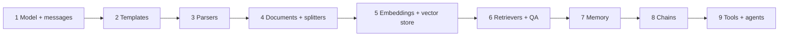
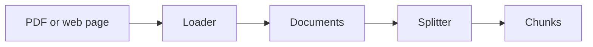
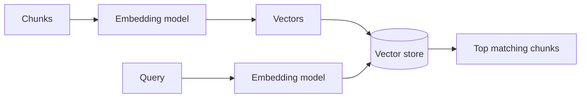
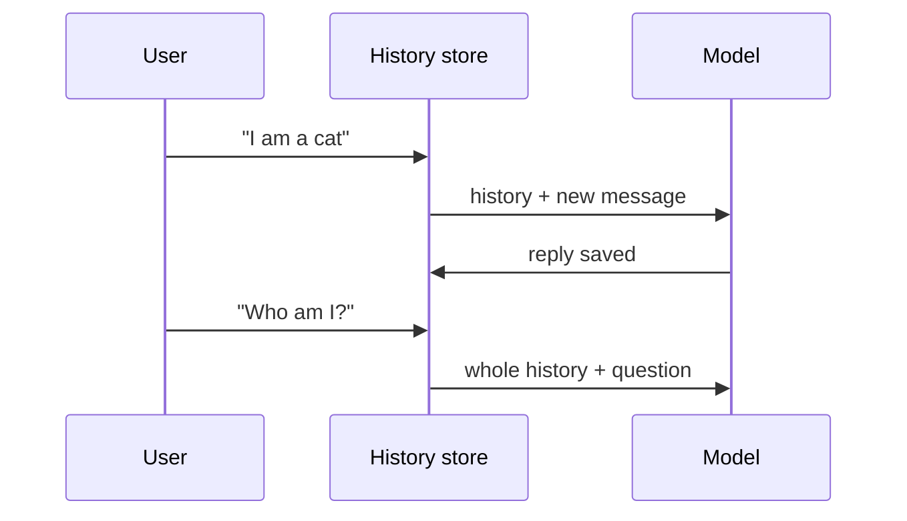
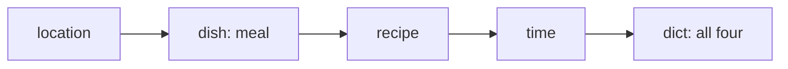
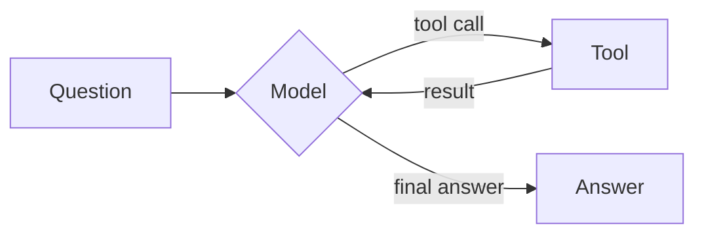

# Tutorial 2: LangChain Building Blocks (LangChain + OpenAI)

Follow-along version of the lab **Build Smarter AI Apps: Empower LLMs with LangChain**. The lab uses watsonx.ai, Chroma and pinned LangChain 0.2 classes. Here you use current LangChain with OpenAI. Each concept from the lab appears in the lab's order, because each one fixes a problem the last one left.

**What you will be able to do**

- Call a chat model with system, human and AI messages.
- Fill prompt templates and parse replies into JSON or lists.
- Load a PDF, split it, embed it, search it, and answer questions from it.
- Give a chat memory, chain steps together, and build a tool-using agent.

Related: the longer guide is [course1 module2 tutorial 1](../../course1-develop-generative-ai-application/module2/tutorials/01-langchain-lab-adapted.md). Previous: [Tutorial 1](01-prompting-and-prompt-templates.md).

## How to use this guide

1. New notebook at the repo root, root `.venv` as the kernel. `OPENAI_API_KEY` is in the root `.env`.
2. Type each **Type this** block yourself. Later blocks reuse earlier names.
3. Each step: **The problem**, **The fix**, **Type this**, **What you should see**, **Try it**.
4. LLM text varies. Expect the idea, not the exact words.



---

## Step 1: Model and messages

**The problem.** You need to talk to a model, and to tell it who it is ("system") separately from what the user says.

**The fix.** A chat model takes a list of messages. Each message has a role: `SystemMessage` (rules), `HumanMessage` (user), `AIMessage` (earlier model replies).

**Type this.**

```python
from dotenv import load_dotenv
from langchain_openai import ChatOpenAI
from langchain_core.messages import SystemMessage, HumanMessage, AIMessage

load_dotenv()
llm = ChatOpenAI(model="gpt-4o-mini", temperature=0.2, max_tokens=256)

print(llm.invoke("Who is man's best friend?").content)
```

```python
reply = llm.invoke([
    SystemMessage(content="You suggest fitness activities in one short sentence."),
    HumanMessage(content="I like high-intensity workouts, what should I do?"),
    AIMessage(content="You should try a CrossFit class."),
    HumanMessage(content="How often should I attend?"),
])
print(reply.content)
```

**What you should see.** "Dog", then a one-sentence answer about attending CrossFit a few times a week. The answer fits only because the model saw the earlier turns.

> **Lab says / today we use:** the lab calls `ModelInference(...)` (watsonx) and wraps it in `WatsonxLLM`. We use `ChatOpenAI`, which takes messages natively and returns an `AIMessage`. Read the text from `.content`.

**Try it.** Send only `HumanMessage("How often should I attend?")`. The model has no idea what "attend" refers to. Lab Exercise 1: compare `temperature=0.1` and `temperature=0.8` on the same prompt (the lab compares two models; you can too with `gpt-4o-mini` and another OpenAI model).

---

## Step 2: Prompt templates

**The problem.** You rebuild the same message text each time.

**The fix.** Templates with placeholders. `PromptTemplate` makes a string prompt. `ChatPromptTemplate` makes a list of messages. `MessagesPlaceholder` leaves a slot for a whole list of messages.

**Type this.**

```python
from langchain_core.prompts import PromptTemplate, ChatPromptTemplate, MessagesPlaceholder

string_prompt = PromptTemplate.from_template("Tell me one {adjective} joke about {topic}")
print(string_prompt.invoke({"adjective": "funny", "topic": "cats"}))
```

```python
chat_prompt = ChatPromptTemplate.from_messages([
    ("system", "You are a helpful assistant"),
    ("user", "Tell me a joke about {topic}"),
])
print(chat_prompt.invoke({"topic": "cats"}).to_messages())
```

```python
slot_prompt = ChatPromptTemplate.from_messages([
    ("system", "You are a helpful assistant"),
    MessagesPlaceholder("msgs"),
])
chain = slot_prompt | llm
print(chain.invoke({"msgs": [HumanMessage(content="What is the day after Tuesday?")]}).content)
```

**What you should see.** A formatted prompt object, a list of two messages, then "Wednesday". The `|` joins prompt and model into a **chain**.

**Try it.** Add a `{language}` variable to the system message so the answer arrives in that language.

---

## Step 3: Output parsers

**The problem.** Your program needs a dict or a list. The model returns prose.

**The fix.** A **parser** converts the reply, and also supplies **format instructions** that you put into the prompt so the model knows the shape to follow.

**Type this.**

```python
from pydantic import BaseModel, Field
from langchain_core.output_parsers import JsonOutputParser

class Joke(BaseModel):
    setup: str = Field(description="question to set up a joke")
    punchline: str = Field(description="answer to resolve the joke")

parser = JsonOutputParser(pydantic_object=Joke)
prompt = PromptTemplate(
    template="Answer the user query.\n{format_instructions}\n{query}\n",
    input_variables=["query"],
    partial_variables={"format_instructions": parser.get_format_instructions()},
)
print((prompt | llm | parser).invoke({"query": "Tell me a joke."}))
```

**What you should see.** A real Python dict: `{'setup': '...', 'punchline': '...'}`.

```python
from langchain_core.output_parsers import CommaSeparatedListOutputParser

list_parser = CommaSeparatedListOutputParser()
list_prompt = PromptTemplate(
    template="{query}\n{format_instructions}",
    input_variables=["query"],
    partial_variables={"format_instructions": list_parser.get_format_instructions()},
)
print((list_prompt | llm | list_parser).invoke({"query": "List 5 ice cream flavors"}))
```

**What you should see.** A Python list of five strings.

> **Lab says / today we use:** `from langchain_core.pydantic_v1 import BaseModel` (removed). Use plain `from pydantic import BaseModel, Field`. `CommaSeparatedListOutputParser` now lives in `langchain_core.output_parsers`.

**Try it.** Lab Exercise 2: make a parser that returns `title`, `director`, `year`, `genre` for a movie you name.

**Beyond the lab.** `llm.with_structured_output(Joke)` does the same job and returns a `Joke` object, using the model's built-in structured output instead of prompt instructions.

---

## Step 4: Documents, loaders and splitters

**The problem.** Your knowledge lives in files, and a model has a limited context window. You cannot paste a 6-page paper into every prompt.

**The fix.** A `Document` holds text and metadata. A **loader** makes Documents from a file. A **splitter** cuts them into small, overlapping **chunks**.

**Type this.**

```python
from langchain_core.documents import Document

doc = Document(
    page_content="Python is an interpreted high-level programming language that emphasizes readability.",
    metadata={"my_document_id": 234234, "my_document_source": "About Python"},
)
print(doc.metadata)
```

```python
from langchain_community.document_loaders import PyPDFLoader

url = "https://cf-courses-data.s3.us.cloud-object-storage.appdomain.cloud/96-FDF8f7coh0ooim7NyEQ/langchain-paper.pdf"
pages = PyPDFLoader(url).load()  # one Document per page
print(len(pages), pages[1].metadata["page"])
print(pages[1].page_content[:300])
```

```python
from langchain_text_splitters import CharacterTextSplitter

splitter = CharacterTextSplitter(chunk_size=200, chunk_overlap=20, separator="\n")
chunks = splitter.split_documents(pages)
print(len(chunks))
print(chunks[5].page_content)
```

**What you should see.** 6 pages, then dozens of chunks of roughly 200 characters. Overlap of 20 characters repeats the edge of a chunk so a sentence is not cut with no context.

**Try it.** Change `chunk_size` to 800. How does the chunk count change? Lab Exercise 3 compares `CharacterTextSplitter` with `RecursiveCharacterTextSplitter` (it tries paragraph, line, word, then character breaks).

```python
# needs: beautifulsoup4  (uv add beautifulsoup4)
from langchain_community.document_loaders import WebBaseLoader

web_pages = WebBaseLoader("https://python.langchain.com/docs/introduction/").load()
print(len(web_pages))
```

> **Lab says / today we use:** `from langchain.text_splitter import ...` moved to `langchain_text_splitters`. The lab's docs URL is a `v0.2` page. Use the current docs URL.



---

## Step 5: Embeddings and a vector store

**The problem.** Keyword search misses meaning. "pet" should find "dog".

**The fix.** An **embedding** turns text into a list of numbers where similar meaning means nearby numbers. A **vector store** stores chunk vectors and returns the nearest ones for a query.

**Type this.**

```python
from langchain_openai import OpenAIEmbeddings
from langchain_core.vectorstores import InMemoryVectorStore

embeddings = OpenAIEmbeddings(model="text-embedding-3-small")
vector = embeddings.embed_query("LangChain")
print(len(vector), vector[:3])
```

```python
store = InMemoryVectorStore.from_documents(chunks, embeddings)
hits = store.similarity_search("LangChain", k=2)
print(hits[0].page_content)
```

**What you should see.** A vector of 1536 numbers, then the chunk most about LangChain.

> **Lab says / today we use:** the lab embeds with `WatsonxEmbeddings` and stores in `Chroma`. We use OpenAI embeddings and the built-in `InMemoryVectorStore`, so there is nothing extra to install. The calls (`from_documents`, `similarity_search`, `as_retriever`) are the same in Chroma. Also, the lab sets `TRUNCATE_INPUT_TOKENS: 3`, which cuts every chunk to 3 tokens. That is a demo setting that would ruin real search, so we do not copy it.

**Try it.** Search for "chains and agents". Does the top hit make sense?



---

## Step 6: Retrievers and question answering

**The problem.** Search returns chunks. You want an answer, and small chunks sometimes lose their surrounding context.

**The fix.** A **retriever** is a standard "query in, documents out" object. Feed its results to the model with the question (RAG). For better context, a **parent-document** retriever searches small chunks but returns the larger parent chunk.

**Type this.**

```python
from langchain_core.output_parsers import StrOutputParser
from langchain_core.runnables import RunnablePassthrough

retriever = store.as_retriever(search_kwargs={"k": 4})

def join_docs(docs):
    return "\n\n".join(d.page_content for d in docs)

qa_prompt = ChatPromptTemplate.from_template(
    "Answer using only this context. If it is not there, say you don't know.\n\n"
    "Context:\n{context}\n\nQuestion: {question}"
)
qa = {"context": retriever | join_docs, "question": RunnablePassthrough()} | qa_prompt | llm | StrOutputParser()

print(qa.invoke("What is LangChain?"))
```

**What you should see.** An answer built from the paper's text.

> **Lab says / today we use:** `RetrievalQA.from_chain_type(llm, chain_type="stuff", retriever=...)`. That class is legacy. The LCEL chain above does the same "stuff the chunks into the prompt" step in four visible lines.

Parent-document retrieval, hand-built so you see what it does:

```python
big = CharacterTextSplitter(chunk_size=2000, chunk_overlap=20, separator="\n")
small = CharacterTextSplitter(chunk_size=400, chunk_overlap=20, separator="\n")

parents = big.split_documents(pages)
children, parent_of = [], {}
for i, parent in enumerate(parents):
    for child in small.split_documents([parent]):
        child.metadata["parent_id"] = i
        children.append(child)

child_store = InMemoryVectorStore.from_documents(children, embeddings)

def parent_retrieve(query):
    found = child_store.similarity_search(query, k=3)
    ids = sorted({d.metadata["parent_id"] for d in found})
    return [parents[i] for i in ids]

print(parent_retrieve("LangChain")[0].page_content[:300])
```

**What you should see.** A longer passage than step 5 returned, because the match was on a small child and the answer is the parent.

**Try it.** Plug `parent_retrieve` into the `qa` chain: replace `retriever | join_docs` with `parent_retrieve | join_docs`. Lab Exercise 4 builds the same QA over a web page.

---

## Step 7: Memory

**The problem.** Each call is independent. Say "I'm Sam", then ask "who am I?" and the model has no idea.

**The fix.** Keep a **message history** and send it with every call. `RunnableWithMessageHistory` does this for you, keyed by a session id.

**Type this.**

```python
from langchain_core.chat_history import InMemoryChatMessageHistory
from langchain_core.runnables.history import RunnableWithMessageHistory

chat_prompt = ChatPromptTemplate.from_messages([
    ("system", "You are a friendly assistant."),
    MessagesPlaceholder("history"),
    ("human", "{input}"),
])

sessions = {}
def get_history(session_id):
    return sessions.setdefault(session_id, InMemoryChatMessageHistory())

chat = RunnableWithMessageHistory(
    chat_prompt | llm, get_history,
    input_messages_key="input", history_messages_key="history",
)
cfg = {"configurable": {"session_id": "cat"}}

print(chat.invoke({"input": "Hello, I am a little cat. Who are you?"}, cfg).content)
print(chat.invoke({"input": "Who am I?"}, cfg).content)
```

**What you should see.** The second answer says you are a little cat. Check `sessions["cat"].messages` to see all four stored messages.

> **Lab says / today we use:** `ChatMessageHistory`, `ConversationBufferMemory` and `ConversationChain`, which are removed or legacy. `InMemoryChatMessageHistory` is the same idea (a list of messages), and the wrapper adds it to the prompt.

**Try it.** Use a new `session_id` and ask "Who am I?". The memory is separate per session. Lab Exercise 5: pre-load a history with `sessions["x"].add_user_message(...)` and `add_ai_message(...)`.



---

## Step 8: Chains

**The problem.** A task needs several model calls, where each uses the last output.

**The fix.** Chain them with `|`. The lab shows the old `LLMChain` and `SequentialChain` and then the LCEL way. Skip straight to the LCEL way.

**Type this.**

```python
from langchain_core.runnables import RunnablePassthrough

dish = (PromptTemplate.from_template(
    "Name one classic dish from {location}. Reply with the dish name only.") | llm | StrOutputParser())
recipe = (PromptTemplate.from_template(
    "Give a short, simple home recipe for {meal}.") | llm | StrOutputParser())
timing = (PromptTemplate.from_template(
    "Given this recipe, estimate the total cooking time:\n{recipe}") | llm | StrOutputParser())

pipeline = (
    RunnablePassthrough.assign(meal=dish)
    | RunnablePassthrough.assign(recipe=recipe)
    | RunnablePassthrough.assign(time=timing)
)
result = pipeline.invoke({"location": "China"})
print(result["meal"])
print(result["time"])
```

**What you should see.** A dict with `location`, `meal`, `recipe` and `time`. Each `assign` adds a key and keeps the earlier ones, so every step can see what came before. This is what `SequentialChain` with `output_key` did.

**Try it.** Lab Exercise 6: given a product review, chain "summarize", then "find the sentiment of the summary", then "write a reply to the customer".



---

## Step 9: Tools and agents

**The problem.** A model cannot do reliable math, or look at your systems. It just writes text.

**The fix.** A **tool** is a Python function with a name and description. An **agent** is a loop: the model decides to call a tool, sees the result, and repeats until it can answer.

**Type this.**

```python
from langchain_core.tools import tool

@tool
def calculator(expression: str) -> str:
    """Evaluate a simple arithmetic expression such as '3 * (4 + 5)'."""
    allowed = set("0123456789+-*/(). ")
    if not set(expression) <= allowed:
        return "Only numbers and + - * / ( ) are allowed."
    return str(eval(expression))

@tool
def search_weather(location: str) -> str:
    """Get the current weather for a location."""
    return f"The weather in {location} is sunny and 72F."  # stand-in for a real API

print(calculator.invoke({"expression": "3 * (4 + 5)"}))
```

```python
from langchain.agents import create_agent

agent = create_agent(llm, tools=[calculator, search_weather])
out = agent.invoke({"messages": [("user", "What is 123 * 45, and what is the weather in Paris?")]})
for m in out["messages"]:
    print(m.type, "->", (m.content or m.tool_calls))
```

**What you should see.** A trace: the user message, an AI message that calls tools, tool results, then a final AI answer: 5535 and sunny.

> **Lab says / today we use:** `PythonREPL` from `langchain_experimental`, a hand-written ReAct prompt with `{tools}`, `{tool_names}` and `{agent_scratchpad}`, `create_react_agent` and `AgentExecutor`. Modern chat models support **tool calling**, so the model returns a structured request instead of text you parse. `create_agent` needs no prompt template. The idea (think, act, observe, repeat) is the same. We also replace the open Python REPL with a restricted calculator, since running arbitrary model-written code is unsafe.

**Try it.** Add a third tool, such as `word_count(text)`, and ask a question that needs it.



---

## Common mistakes

| Symptom | Cause | Fix |
|---|---|---|
| `ModuleNotFoundError: langchain_core.pydantic_v1` | Old lab import | `from pydantic import BaseModel, Field` |
| `ImportError: ConversationBufferMemory` | Removed class | Use `RunnableWithMessageHistory` |
| Parser raises on reply | Model added prose around JSON | Keep format instructions in the prompt; lower temperature |
| Empty search results | Vector store built from empty list | Print `len(chunks)` first |
| Memory "forgets" | Different `session_id` per call | Reuse the same id |
| Agent never calls a tool | Weak tool docstring | Describe exactly when to use it |

## Cheat sheet

| Need | Use |
|---|---|
| Model | `ChatOpenAI(model="gpt-4o-mini")` |
| Messages | `SystemMessage`, `HumanMessage`, `AIMessage` |
| Template | `PromptTemplate`, `ChatPromptTemplate`, `MessagesPlaceholder` |
| Parse | `JsonOutputParser`, `CommaSeparatedListOutputParser`, `StrOutputParser` |
| Load, split | `PyPDFLoader`, `CharacterTextSplitter` |
| Embed, store | `OpenAIEmbeddings`, `InMemoryVectorStore` |
| Retrieve | `store.as_retriever(search_kwargs={"k": 4})` |
| Memory | `RunnableWithMessageHistory` |
| Chain | `a \| b \| c`, `RunnablePassthrough.assign(...)` |
| Agent | `@tool` + `create_agent(llm, tools=[...])` |

## Practice

1. Parse a recipe into JSON with `name`, `ingredients` (list) and `minutes` (number) using a Pydantic model.
2. Load the PDF, then compare answers to "What is LangChain?" with chunk sizes 200 and 1000.
3. Make the QA chain print the page numbers of the chunks it used.
4. Give the chat memory a system persona and keep only the last 4 messages.
5. Build an agent with two tools of your own and write down the order of its tool calls.

Next: [Tutorial 3, RAG over private documents](03-rag-private-documents.md).
