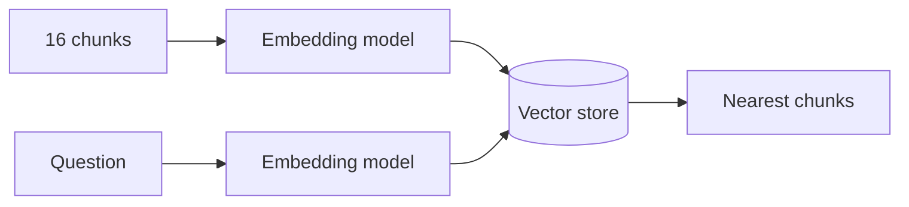
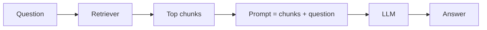
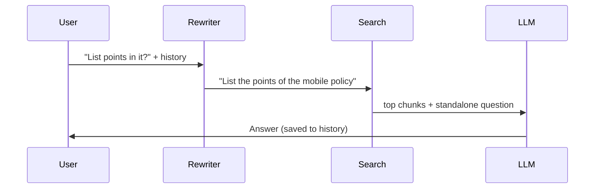
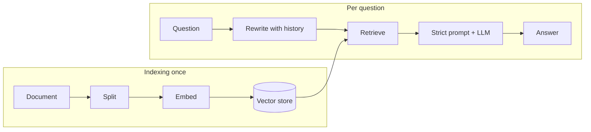

# Tutorial 3: Ask Questions About Private Documents with RAG (LangChain + OpenAI)

Follow-along version of the lab **Summarize Private Documents Using RAG, LangChain, and LLMs**. The lab uses watsonx.ai, Hugging Face embeddings, Chroma, `RetrievalQA` and `ConversationalRetrievalChain`. Here you build the same bot with OpenAI and current LangChain. Each step starts with a problem you just saw.

**What you will be able to do**

- Split a private document into chunks, embed them, and store them for search.
- Answer questions from the document with retrieval-augmented generation (RAG).
- Make the bot say "I don't know" instead of inventing facts.
- Give it memory so follow-up questions like "what is the aim of it?" work.

Related: the longer guide is [course2 module1 tutorial 1](../../course2/module1/tutorials/01-rag-study-guide-and-lab-adapted.md). Previous: [Tutorial 2](02-langchain-building-blocks.md).

## How to use this guide

1. New notebook (or `.py` file) **at the repo root**, root `.venv`. `OPENAI_API_KEY` is in the root `.env`.
2. The document is already in the repo: `course2/module1/companyPolicies.txt` (the lab's Innovatech policies, nine sections). No download needed.
3. Type each **Type this** block in order. Later blocks reuse earlier names.
4. LLM text varies. Expect the idea, not the exact words.


---

## Step 0: Read the document

**The problem.** A model knows the internet, not your company's rules. Ask it "what is the mobile policy?" and it can only guess.

**The fix.** Keep your document and hand the model the relevant part with each question. First, look at what you have.

**Type this.**

```python
from pathlib import Path
from dotenv import load_dotenv

load_dotenv()
text = Path("course2/module1/companyPolicies.txt").read_text()
print(len(text), "characters")
print(text[:400])
```

**What you should see.** About 15 thousand characters, starting with "1. Code of Conduct".

**Try it.** Find the "Mobile Phone Policy" section yourself and read it. You will check the bot against it later.

---

## Step 1: Split into chunks

**The problem.** The whole document is too long to send every time, and most of it is irrelevant to any one question.

**The fix.** Cut it into chunks (~1000 characters). This is the **split** stage of **indexing**.

**Type this.**

```python
from langchain_community.document_loaders import TextLoader
from langchain_text_splitters import CharacterTextSplitter

documents = TextLoader("course2/module1/companyPolicies.txt").load()
splitter = CharacterTextSplitter(chunk_size=1000, chunk_overlap=0)
texts = splitter.split_documents(documents)
print(len(texts))
print(texts[3].page_content[:200])
```

**What you should see.** Around 16 chunks (the lab says 16), each a few paragraphs.

> **Lab says / today we use:** same loader and splitter. `CharacterTextSplitter` is imported from `langchain_text_splitters`. Splitting happens on blank lines first, so a chunk can be somewhat over 1000 characters if one paragraph is long.

**Try it.** Use `chunk_size=300, chunk_overlap=50` and see how `len(texts)` changes.

---

## Step 2: Embed and store

**The problem.** To find "the chunks about phones" you need search by meaning, not exact words.

**The fix.** An **embedding** is a list of numbers that captures a text's meaning. Store one per chunk in a **vector store**. Finding similar meaning becomes finding nearby vectors.

**Type this.**

```python
from langchain_openai import OpenAIEmbeddings
from langchain_core.vectorstores import InMemoryVectorStore

embeddings = OpenAIEmbeddings(model="text-embedding-3-small")
docsearch = InMemoryVectorStore.from_documents(texts, embeddings)

for hit in docsearch.similarity_search("mobile policy", k=2):
    print(hit.page_content[:150].replace("\n", " "))
    print("---")
```

**What you should see.** The top chunk is the mobile phone section, though the chunk may not contain the exact words "mobile policy".

> **Lab says / today we use:** `HuggingFaceEmbeddings()` (a local model) with `Chroma`. We use OpenAI embeddings (one API call, no big download) and the built-in `InMemoryVectorStore` (nothing to install). `from_documents` and `similarity_search` are identical in Chroma. The store disappears when your program ends. That is fine here.

**Try it.** Search "Can I bring my own laptop?" Which section comes back?



Steps 0 to 2 are **indexing**. You do it once per document.

---

## Step 3: Retrieve, then answer

**The problem.** Search returns raw chunks. You want a written answer.

**The fix.** Put the retrieved chunks and the question into one prompt for the model. That is **RAG**: retrieve, augment, generate.

**Type this.**

```python
from langchain_openai import ChatOpenAI
from langchain_core.prompts import ChatPromptTemplate
from langchain_core.output_parsers import StrOutputParser
from langchain_core.runnables import RunnablePassthrough

llm = ChatOpenAI(model="gpt-4o-mini", temperature=0)
retriever = docsearch.as_retriever()  # returns the 4 nearest chunks by default

def join_docs(docs):
    return "\n\n".join(d.page_content for d in docs)

prompt = ChatPromptTemplate.from_template(
    "Use the context to answer the question.\n\nContext:\n{context}\n\nQuestion: {question}"
)
qa = {"context": retriever | join_docs, "question": RunnablePassthrough()} | prompt | llm | StrOutputParser()

print(qa.invoke("what is mobile policy?"))
```

**What you should see.** A summary of the mobile phone policy that matches the document.

> **Lab says / today we use:** `RetrievalQA.from_chain_type(llm=llm, chain_type="stuff", retriever=...)`. "Stuff" means the chunks are pasted into the prompt, which is exactly what `join_docs` plus the prompt do. `RetrievalQA` is legacy and lives in `langchain_classic`. The LCEL chain is shorter to read and lets you see the prompt. Also, the lab uses `llm=WatsonxLLM(... min_new_tokens=130)`. Ignore that. `temperature=0` gives steady answers.

**Try it.** Print `retriever.invoke("what is mobile policy?")` to see what the model was given. Does it contain the answer? When an answer is wrong, this is the first thing to check.



---

## Step 4: A wider question

**The problem.** Ask "Can you summarize the document for me?"

**Type this.**

```python
print(qa.invoke("Can you summarize the document for me?"))
```

**What you should see.** A partial summary covering only some of the nine policies. The retriever sends only four chunks, picked for similarity to the word "summarize", so most of the document never reaches the model.

**The fix.** For whole-document questions, retrieve more chunks, or send everything if it fits the model's context.

```python
wide = docsearch.as_retriever(search_kwargs={"k": 16})
qa_wide = {"context": wide | join_docs, "question": RunnablePassthrough()} | prompt | llm | StrOutputParser()
print(qa_wide.invoke("Can you summarize the document for me?"))
```

**What you should see.** A summary that touches all nine policies.

**Why it works.** RAG answers from what was retrieved. `k` is the number of chunks you hand over. Specific questions need a small `k`, broad ones need a large `k`.

**Try it.** Try `k=8`. How many of the nine policies appear?

---

## Step 5: Stop it guessing

**The problem.** Ask something the document does not cover.

**Type this.**

```python
print(qa.invoke("Can I eat in company vehicles?"))
```

**What you should see.** A confident-sounding answer. Part of it may come from the model's general knowledge or from loosely related text (for example a smoking rule), not a real rule about eating.

**The fix.** Tell the model to answer only from the context and to say "I don't know" otherwise.

```python
strict_prompt = ChatPromptTemplate.from_template(
    "Use the information from the document to answer the question at the end. "
    "If you don't know the answer, just say that you don't know, "
    "definitely do not try to make up an answer.\n\n"
    "{context}\n\nQuestion: {question}"
)
strict_qa = {"context": retriever | join_docs, "question": RunnablePassthrough()} | strict_prompt | llm | StrOutputParser()

print(strict_qa.invoke("Can I eat in company vehicles?"))
print(strict_qa.invoke("what is mobile policy?"))
```

**What you should see.** An "I don't know" style reply for the first, and still a good answer for the second.

> **Lab says / today we use:** `chain_type_kwargs={"prompt": PROMPT}` passed into `RetrievalQA`. Here the prompt is just a part of the chain, so there is nothing to pass in.

**Try it.** Ask three questions whose answers are in the document and three whose answers are not. Does the strict prompt ever refuse something it should answer?

---

## Step 6: Memory

**The problem.** Follow-up questions fail.

**Type this.**

```python
print(strict_qa.invoke("What I cannot do in it?"))
```

**What you should see.** Confusion or an unrelated answer. The bot has no idea what "it" is, and the retriever searched with that vague phrase.

**The fix.** Two jobs: remember earlier turns, and **rewrite** a follow-up into a standalone question ("What can't I do with a mobile phone at work?") before searching. This is what the lab's `ConversationalRetrievalChain` does inside.

**Type this.**

```python
rewrite_prompt = ChatPromptTemplate.from_template(
    "Chat history:\n{history}\n\nRewrite the follow-up as a standalone question. "
    "If it is already standalone, return it unchanged. Return only the question.\n\n"
    "Follow-up: {question}"
)
rewrite = rewrite_prompt | llm | StrOutputParser()

history = []  # list of (question, answer) pairs

def ask(question):
    past = "\n".join(f"User: {q}\nBot: {a}" for q, a in history) or "(none)"
    standalone = rewrite.invoke({"history": past, "question": question})
    answer = strict_qa.invoke(standalone)
    history.append((question, answer))
    return answer

print(ask("What is mobile policy?"))
print(ask("List points in it?"))
print(ask("What is the aim of it?"))
```

**What you should see.** The second and third answers are about the mobile phone policy, though they say only "it".

**Why it works.** The model sees the history only in the rewrite step. Search then gets a complete question. Print `standalone` inside `ask` to watch the rewrite.

> **Lab says / today we use:** `ConversationBufferMemory(memory_key="chat_history")` plus `ConversationalRetrievalChain.from_llm(...)`, then `history.append(...)` by hand. Both are legacy (and the lab passes the history twice, in the memory and manually). Our `history` list and `rewrite` chain make the same flow explicit.

**Try it.** Change the first question to a different policy and repeat the follow-ups. Add a cap: use only `history[-4:]` in `ask`.



---

## Step 7: A chat loop (the lab's "agent")

**The problem.** You want to chat, not call a function each time.

**The fix.** Wrap `ask` in a loop. The lab calls this an agent, but it only has one skill: answer from the document.

**Type this.** (Run in a terminal script or a notebook cell. Type `quit` to stop.)

```python
# needs: interactive input (run as a script, not through the snippet checker)
def chat():
    history.clear()
    while True:
        query = input("Question: ")
        if query.strip().lower() in {"quit", "exit", "bye"}:
            print("Goodbye!")
            break
        print("Answer:", ask(query))

chat()
```

**What you should see.** A prompt that answers with follow-up memory, and ends when you type `quit`.

---

## Putting it together



## Common mistakes

| Symptom | Cause | Fix |
|---|---|---|
| `FileNotFoundError: companyPolicies.txt` | Not running from repo root | Run from the repo root, or use the full path |
| Answer ignores the document | Wrong chunks retrieved | Print `retriever.invoke(q)` and read them |
| Summary is partial | `k` too small | Raise `k`, or send the whole text |
| Made-up answer | Prompt allows general knowledge | Use the strict prompt |
| "It" follow-ups fail | No history rewrite | Use the `ask` function |
| Slow or costly re-indexing | Rebuilding the store each run | Build once, reuse `docsearch` |

## Cheat sheet

| Stage | Code |
|---|---|
| Load | `TextLoader(path).load()` |
| Split | `CharacterTextSplitter(chunk_size=1000, chunk_overlap=0).split_documents(docs)` |
| Embed + store | `InMemoryVectorStore.from_documents(texts, OpenAIEmbeddings(model="text-embedding-3-small"))` |
| Retrieve | `docsearch.as_retriever(search_kwargs={"k": 4})` |
| Answer | `{"context": retriever \| join_docs, "question": RunnablePassthrough()} \| prompt \| llm \| StrOutputParser()` |
| Memory | rewrite follow-up with history, then retrieve |

## Practice (the lab's exercises, with OpenAI)

1. **Your own document.** Index a text file of your own (or another policies file) and ask it 5 questions.
2. **Return sources.** Show which chunk(s) each answer came from. Hint: keep the retrieved `Document` list and print each `metadata` and the first 100 characters.
3. **Another model.** Swap `gpt-4o-mini` for another OpenAI chat model. Do the answers or the "I don't know" behavior change?
4. Make `chunk_size` 300 versus 1500 and compare answer quality on 5 questions.
5. Save the vector store to disk so you do not re-embed on every run (hint: a persistent store such as Chroma, installed with `uv add langchain-chroma`).

You have now rebuilt the three labs with LangChain and OpenAI. For the web app version of this bot, see [course2 module1 tutorial 3](../../course2/module1/tutorials/03-build-the-rag-lab-web-app.md).
